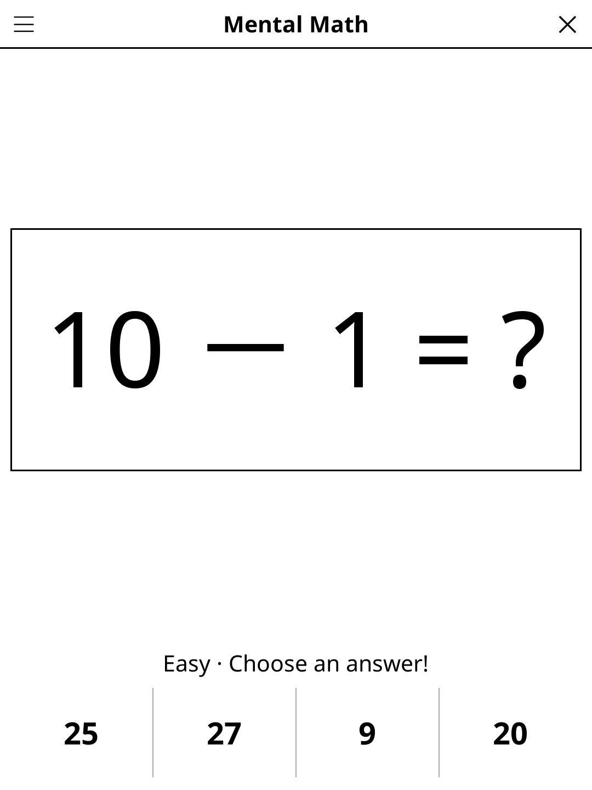

# mentalmath.koplugin

A Mental Arithmetic plugin for [KOReader](https://github.com/koreader/koreader).

## Screenshot

## Rules

Solve arithmetic equations as quickly as possible. Each exercise shows a missing value — select the correct answer from the choices provided. Operations cover addition, subtraction, multiplication, and division.

## Features

- **Four operations** — +, −, ×, ÷
- **Three difficulty levels** — Easy, Medium, Hard, chosen in the menu
- **Plausible wrong answers** — tens slips, off-by-ones and neighbouring
  times-table lines, so the units digit alone rarely gives the answer away
- **Score tracker** — records best performance
- **Auto-save** — progress saved on exit

## Multiplayer

Pick **Mental Math · multiplayer** under Tools → Games → Party & quiz (or
*Mode: Multiplayer* in the menu) and lay the reader in the middle of the
table — a buzzer game for 2 to 8 players.

- One calculation is shown very big. Players shout the answer.
- Tap **Answer** to reveal it, then pick who was first and right (or
  *Nobody*): one point.
- **Settings:** Players and Player names (remembered), Difficulty, Questions
  (10, 15, 20 or 30 per match), Time limit (none, or 5–20 s per question —
  the answer is revealed when it runs out).
- After the last question a final scoreboard names the winner; **New game**
  starts again. A match in progress is saved and restored. Solo play and its
  saved score are unchanged.

## Installation

1. Download `mentalmath.koplugin.zip` from the [latest release](../../releases/latest).
2. Extract into the `plugins/` folder of your KOReader data directory.
3. Restart KOReader.
4. Open the menu → **Tools** → **Mental Arithmetic**.

## Controls

| Action | How |
|--------|-----|
| Select an answer | Tap the answer button |
| Change difficulty | Tap **Difficulty** in the menu |
| New exercise | Tap **New game** in the menu |
| Show rules | Tap **Rules** |

## License

GPL-3.0 — see [LICENSE](LICENSE).
